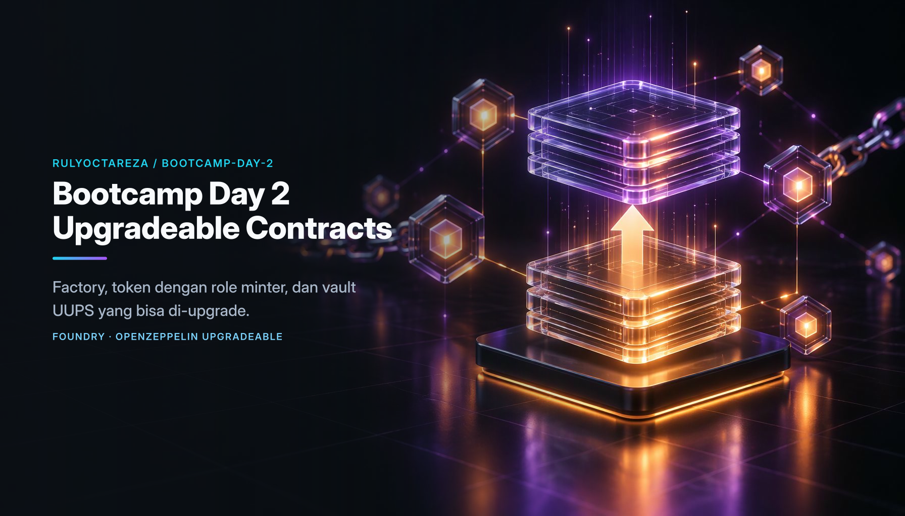

<p align="center">
  
</p>

<h1 align="center">Bootcamp Day 2 — Upgradeable Contracts</h1>

<p align="center">
  <b>Factory, token dengan role minter, dan vault UUPS yang bisa di-upgrade.</b><br>
  Foundry · OpenZeppelin Upgradeable
</p>

<p align="center">
  
  
  
</p>

---

## ✨ Preview

<p align="center">
  
</p>

> **Catatan:** gambar di atas adalah *ilustrasi konsep*, bukan screenshot asli.

---

## 📖 Tentang

Materi bootcamp hari kedua: membangun sistem kontrak yang bisa tumbuh. Ada `Factory` untuk
mendeploy token baru, `Token` ERC-20 dengan kontrol akses berbasis role minter, serta
`Vault` bergaya **UUPS upgradeable** dengan versi keduanya (`VaultV2`).

---

## 📜 Kontrak

| Kontrak | Ringkasan |
|---|---|
| `Factory` | `createToken(name, symbol, minterRole)` — deploy token baru |
| `Token` | ERC-20 + `Ownable` + `AccessControl`: mint/burn, tambah/hapus minter, grant/revoke role |
| `Vault` | `OwnableUpgradeable` + `UUPSUpgradeable` |
| `VaultV2` | Versi upgrade dari Vault |

---

## 🛠️ Tech Stack

| Area | Pilihan |
|---|---|
| Bahasa | Solidity |
| Toolchain | Foundry |
| Library | OpenZeppelin Contracts + Upgradeable |

---

## 🚀 Perintah

```bash
forge build
forge test
forge fmt
anvil
```

Deploy dan upgrade mengikuti skrip di `script/` dan `deploy-script.txt`.

---

## 📁 Struktur

```text
├── src/
│   ├── Factory.sol
│   ├── Token.sol
│   ├── Vault.sol       # UUPS
│   └── VaultV2.sol
├── script/
├── test/
├── deploy-script.txt
└── foundry.toml
```

> ⚠️ Kode latihan. Upgradeable contract butuh review storage layout sebelum dipakai di produksi.
